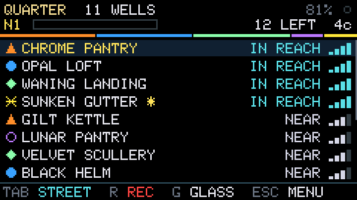
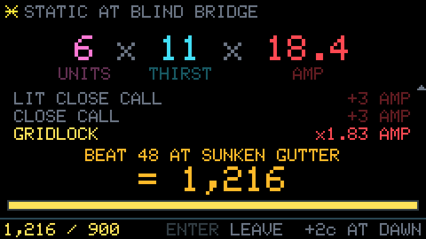
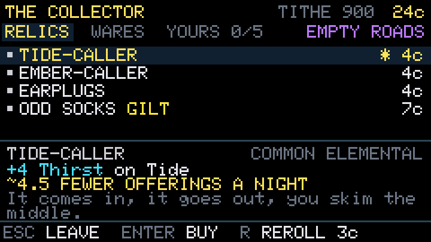
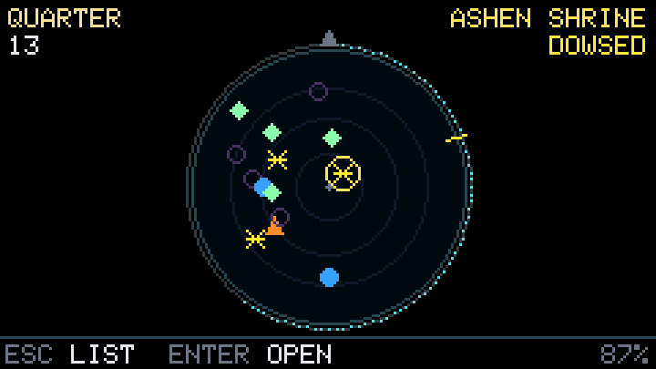

# The Tithe

The Tithe is a go-outside roguelike for the M5Stack Cardputer, inspired by Balatro. Every WiFi
router around you is a well. You walk up to wells, draw their energy, and offer it to the wells
that want it, and each offering rings louder as your relics stack up. A Night gives you twelve
visits to pay the Tithe, seven Nights make a week, and between Nights you spend your coin at the
Collector's stall. The Cardputer in your hand is the Deck, the little terminal that lets you hear
all of this, so everything on the screen is the Deck's own software.

There's more under the game than the manual tells you.

<p>




</p>

## Install it

You don't need to build anything or flash the Cardputer. The Tithe runs from M5Launcher, so it
sits next to whatever else you have installed.

1. Download `Tithe-v0.6.0.bin` from the [Releases page](https://github.com/the-tithe/the-tithe/releases).
2. Copy it to the `/downloads` folder on the Cardputer's microSD card.
3. Put the card back in, open M5Launcher, choose SD, and launch the file from `/downloads`.

Leave the card in while you play. The Deck keeps a backup of your save on it, and it's where the
walk log goes.

The game is made for the Cardputer ADV, which has the motion sensor that dowsing and the hand
gestures use. On the original Cardputer everything else works and those moves are switched off.

## The manual

The manual is [firmware/manual/Tithe-Manual.pdf](firmware/manual/Tithe-Manual.pdf). It starts with
a quick start that gets you through your first Night.

## It only listens

The Deck runs passive scans, which means it hears the networks that are already announcing
themselves and never sends anything to them. It never joins a network. The first time it starts,
it makes a random key that stays on the Deck, and network names and IDs are scrambled with that
key before anything is saved, so the SD card on its own can't be traced back to real networks. No
network names or hardware addresses are ever stored. There's no GPS, no account, and no telemetry.

## Build it from source

Players never need this part. To build the firmware yourself, install
[PlatformIO](https://platformio.org/) and run this from the `firmware` folder:

```bash
pio run -e cardputer      # build the firmware
pio test -e native        # run every test on your computer
```

`pio run -e cardputer -t upload` flashes it over USB, which replaces whatever is on the Cardputer,
so use M5Launcher unless you mean to do that. [firmware/README.md](firmware/README.md) has the
details, including how to back up the Cardputer first.

While a card is in, the Deck logs every scan to a walk log, with every network scrambled. Those
logs are how the game's numbers get checked against real streets: `tools/walk_report.py` compares a
set of walks with the guesses in the balance simulator, and `tools/balance_sim.py` plays thousands
of weeks on either one. [BALANCE.md](BALANCE.md), [DESIGN.md](DESIGN.md) and
[PROGRESSION.md](PROGRESSION.md) explain how the game was tuned.

## Credits

Parts of the firmware are adapted from [Hazke](https://github.com/therezor/hazke) by REZOR, which is
under the MIT license. [firmware/CREDITS.md](firmware/CREDITS.md) lists which parts, with Hazke's
license notice.

The Tithe is inspired by Balatro. It isn't affiliated with LocalThunk, Playstack or M5Stack.

## License

MIT. See [LICENSE](LICENSE).
