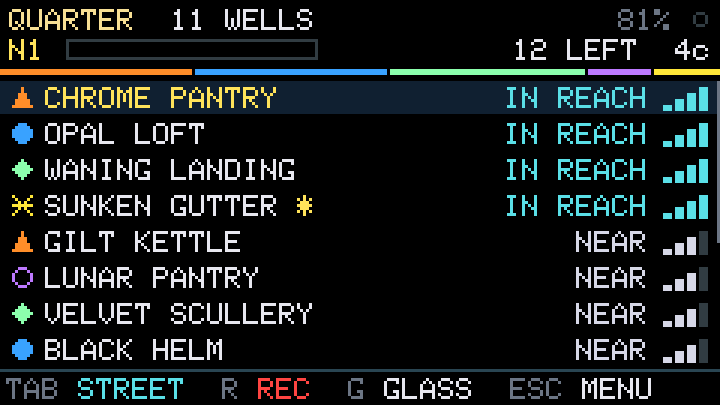
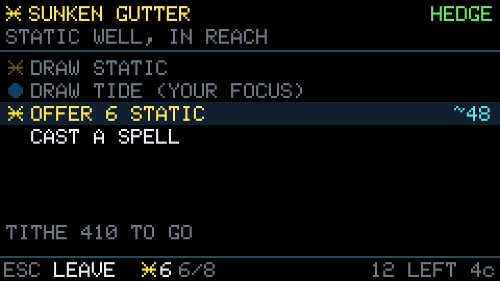
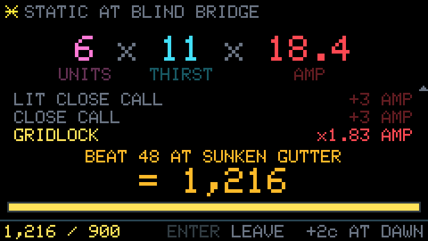
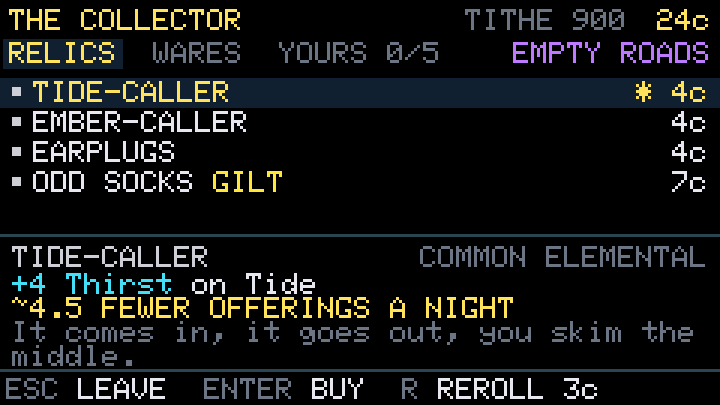
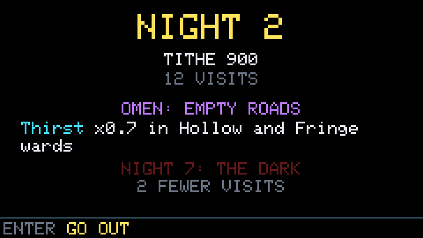
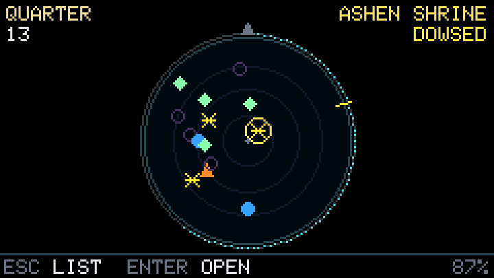
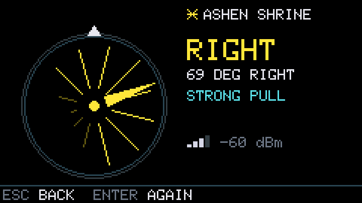
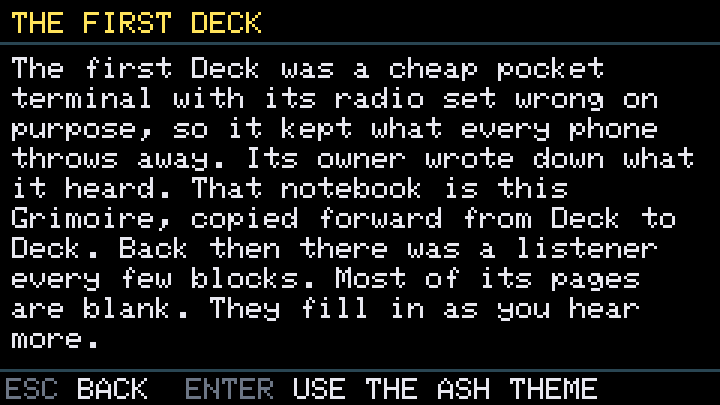

# The Tithe

Firmware for the Cardputer ADV: a roguelike trading game where the WiFi routers around you are
wells of hidden energy. Walk up to one, draw its energy, sell it, and pay each Night's Tithe. A
week is seven Nights, and the Collector's shop between them is where builds break open. The
design is in DESIGN.md, PROGRESSION.md and UPGRADES.md one folder up.

The Tithe is also a calibration tool. It logs scrambled scans to the SD card as you walk, so the
game's numbers can be checked against the real world.

<p>








</p>

## Put it on the Cardputer

Plug the Cardputer in over USB, then from this folder:

```bash
pio run -e cardputer -t upload
```

This replaces whatever firmware is on the Cardputer. If the upload can't find the device, hold the
G0 button while plugging the cable in, then run it again.

To keep what's on it now, save a copy first (about two minutes):

```bash
python3 ~/.platformio/packages/tool-esptoolpy/esptool.py --chip esp32s3 read_flash 0 0x800000 cardputer-backup.bin
```

and to put it back later:

```bash
python3 ~/.platformio/packages/tool-esptoolpy/esptool.py --chip esp32s3 write_flash 0 cardputer-backup.bin
```

## How a Night goes

1. **Bind a week.** Choose a Calling (how the week starts) and a Pact (optional difficulty).
2. **Each Night** shows its Tithe and Omen. You have about 12 visits to pay it.
3. **The scanner** lists the wells around you. The star marks the one where your build makes the
   most right now.
4. **Walk up to a well** until it's NEAR or IN REACH, open it, and press ENTER to visit. **Draw** its
   energy, or your focus energy where it's offered (about half of wells, each Night). Hold the
   Deck still while it draws, or some spills.
5. **Sell** what you carry. The sale plays out relic by relic: Units × Price × Mult. Each well buys
   once a Night, and each sale is one visit.
6. **Pay the Tithe** and the Night closes. Spare visits turn into coin, and paying fast earns
   Portents. Then the Collector's shop.
7. **Out of visits?** Light a candle for one more, take the Syndicate's loan, or let the week go.
   Losing costs only the week. Everything you've unlocked stays.

## Keys

| Key | Does |
|---|---|
| `;` `.` (up and down arrows) | Move through lists |
| `,` `/` (left and right arrows) | Change tabs and choices |
| `Enter` | Open, choose, buy |
| `` ` `` (Esc) | Back. On the scanner, the menu. |
| `G` | The scrying glass |
| `D` | Dowse the open well |
| `B` / `C` | Your build / cast a spell (or type a spell's name on the spell screen) |
| `R` | In the shop, reroll. Elsewhere, start or stop recording the walk. |
| `X` | In the shop's YOURS tab, sell a relic |
| `Tab` | Say where you are, for the walk log: home, street, transit, shop, work or park |
| `M` | Sound on or off |

## Moves

These need the Cardputer ADV, which has a motion sensor. On the original Cardputer they're off.

| Move | Does |
|---|---|
| Turn slowly in a circle while dowsing | Finds which way the well lies. Your body blocks part of the signal from behind, so the Deck hears the difference. Up to 7 readings a second, with a tone that rises as the signal gets stronger. Dowsed wells count for the Dowser's knot relic. |
| Hold the Deck still | While drawing: nothing spills. While selling: Steady hand pays. In the glass: the water clears and Hush wells surface. |
| Tilt the Deck in the glass | The wells drift like things under water, the near ones most |
| Snap your wrist | A pulse: the Deck listens again, and Hush wells ring out for 4 seconds |
| Twist and back, like a steering wheel | A ward: the Wardens can't take your sales for a minute, once a Night |
| Lay it face-down | The Deck veils itself: the screen goes dark, but it keeps listening and recording |
| Pick it up, or turn it face-up | It opens its eye and wakes |
| Put it in a pocket | The screen dims after 5 seconds |

Gestures only count when the Deck has been held up to look at for a moment, so a hand swinging at
your side casts nothing.

## The calibration walk

The game's numbers rest on guesses about how many networks are around a home, a street, a café
and an office. These walks replace the guesses with real numbers.

1. Put a microSD card in. Recording starts by itself at power-on, and the footer shows `REC W1`.
2. Press `Tab` until the footer shows where you are, and change it when you move somewhere else.
3. Try for at least 20 minutes in each kind of place you go: home, your street, a bus or train,
   a shop or café, work, and somewhere empty like a park.
4. Do your usual routes on at least 3 different days. The repeats show how often you pass the same
   wells again.

Then copy the logs and read the report:

```bash
python3 tools/pull_walks.py
python3 ../tools/walk_report.py ../walks --json ../walks/world.json
WORLD=../walks/world.json python3 ../tools/balance_sim.py run 2000
```

`pull_walks.py` copies the logs over the USB cable, so you don't need a card reader. The report
puts each of the simulator's guesses next to what you measured, and the last line plays the
game's balance on your real numbers.

## What the Deck stores

- The game saves to the Deck's own flash after every change, with a backup on the SD card. A
  damaged save fails its checksum and the backup is used instead.
- The Deck makes a random key the first time it starts and keeps it in its own flash. Logs and
  saves hold network IDs scrambled with that key, so an SD card on its own can't be traced back to
  real networks. No network names and no hardware IDs are ever stored.
- A well's name comes from a second key that's the same on every Deck, so a router has the same
  name for every player. Nothing made from that key is stored.
- The Deck only listens. It never joins a network and never sends anything.

## For developers

```bash
pio test -e native                  # every test, on this computer (about 15 s)
pio run -e render && .pio/build/render/program && python3 tools/png.py
                                    # every screen as a PNG in shots/, via a scripted playthrough
python3 ../tools/gen_catalog.py     # after changing tools/catalog.py
python3 ../tools/gen_parity.py      # after changing the rules in tools/balance_sim.py
python3 tools/capture.py NAME shot  # a screenshot from a real Deck
```

The tests:

| Test | Checks |
|---|---|
| `test_core` | Routers into wells, scrambled IDs, the walk log format |
| `test_motion` | Stillness, gestures, heading and dowsing, on made-up hand movements |
| `test_parity` | 3,000 sales scored the same as the balance simulator |
| `test_game` | The run's rules, one by one |
| `test_autoplay` | A bot plays thousands of weeks: outcomes near the simulator's, every Calling and Challenge, no rule ever broken |
| `test_save` | Saves round-trip exactly, and damage is caught |
| `test_app` | The app through key presses, with a reload after every step, and random key mashing on every screen |

The USB console (115200 baud) takes `status`, `game`, `scan`, `wells`, `place <where>`,
`log on|off`, `sound on|off`, `files`, `send <file>`, `imu`, and Hazke's `cap`, `keys`, `step`,
`rec` and `shot`.

| Where | What's in it |
|---|---|
| `src/main.cpp` | The hardware: setup, the frame loop, motion, saving, the USB console |
| `src/App.h`, `src/app/` | The game app: every game screen and what keys do there |
| `src/game/` | The rules: sales, Nights, the shop, careers, the atlas, saves. `CatalogData.h` is generated. |
| `src/Well.h`, `src/Sightings.h`, `src/Scanner.h` | How routers become wells, and the passive scan |
| `src/Motion.h`, `src/Dowse.h`, `src/Imu.h` | How the Deck is held and moved, and dowsing |
| `src/*Screen.h`, `src/UI.h`, `src/Effects.h` | The scanner's screens and the shared look |
| `render/` | Draws every screen on a computer |
| `tools/` | Copying walk logs, screenshots, PNG contact sheets |

Parts are adapted from Hazke. See CREDITS.md.
